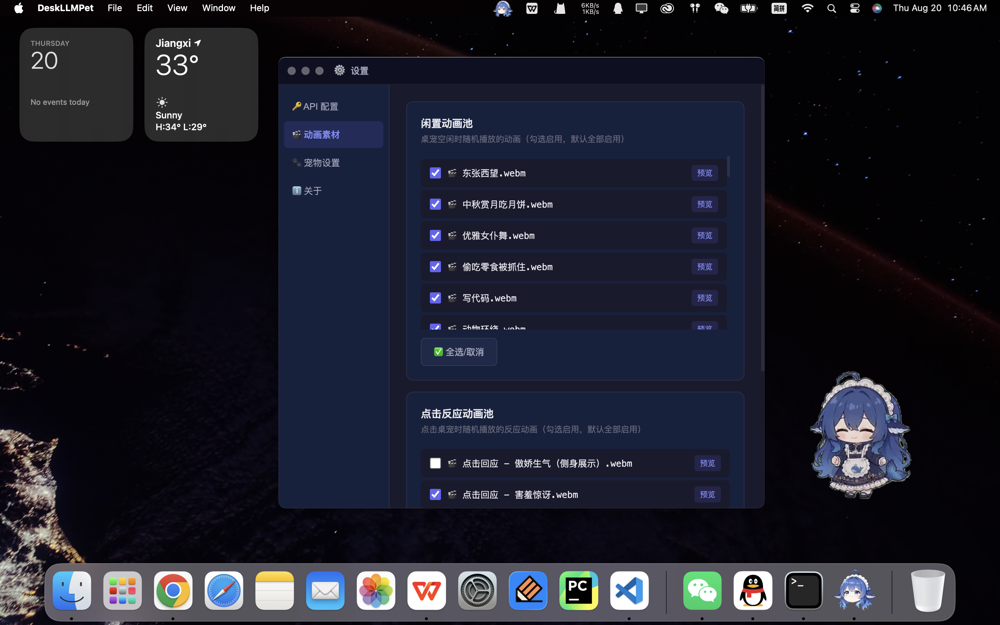
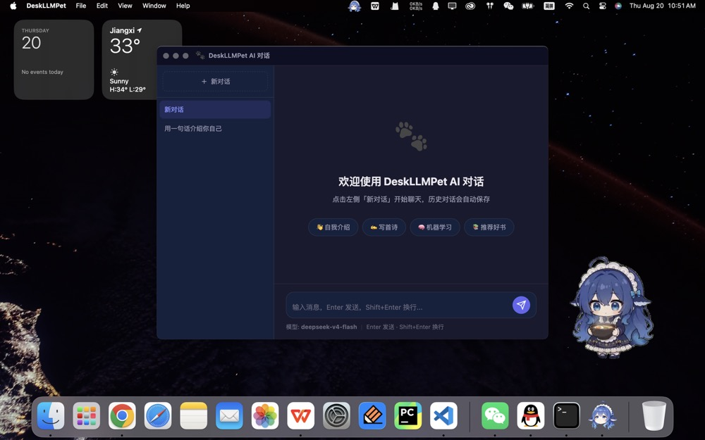

<div align="center">


# 🐾 DeskLLMPet 桌宠大肥鱼 doge~

**会报 API 余额、可插件化扩展（内置 AI 对话）的桌面宠物**

[](LICENSE)
[](https://www.electronjs.org/)
[](#)
[](https://github.com/isKage/desk-llm-pet/releases)
[](https://github.com/isKage/desk-llm-pet/pulls)


</div>

> 本项目**完全由 DeepSeek Harness 生成**。

> 感谢 [dsh-pet](https://github.com/PC2005-cloud/dsh-pet) 项目的灵感，本项目的所有动画素材均来自 dsh-pet 项目。

> 本项目桌宠形象采用【DeepSeek 娘】，侵权则删。提供自定义桌宠形象功能，见后（自定义动画资源需要自行生成）。


---

## ✨ 功能特性

### 🎬 桌面宠物
- **WebM 动画播放**：支持透明通道的 WebM 动画素材
- **随机动画切换**：从闲置动画池中随机挑选播放
- **窗口裁剪**：动画本身保持原大小，窗口只保留中间一块 —— 宠物大小不变，周围不重要的背景被裁掉，窗口更小更贴身（裁剪比例 + 画面水平/垂直偏移，拖动即时预览）
- **点击互动**：**单击**桌宠切换反应动画；**双击**桌宠弹气泡（余额卡片或自定义语句）
- **拖拽移动**：按住宠物拖拽到屏幕任意位置
- **右键菜单**：独立的菜单窗口，尺寸按菜单内容自适应，插件菜单项再多也不会被遮挡

### 💰 API 余额气泡
- **独立气泡窗口**：气泡是单独的透明悬浮窗，浮在宠物上方，**不会遮挡宠物、不挡鼠标操作**；宠物缩小后气泡也不会显得突兀
- **大小 / 位置可调**：气泡大小 0.6~1.6 倍，水平 / 垂直偏移自由调，设置页可一键「预览气泡」
- **余额卡片**：大字号展示总余额，附充值 / 赠送明细与可用状态
- **定时展示**：每隔 t 分钟（可配置，0 表示关闭）自动展示一次
- **双击即查**：双击桌宠立刻查询并展示 DeepSeek 账户余额（单击只播动画）
- **自定义语句**：关闭余额气泡后，双击桌宠会从自定义语句里随机展示一句（设置页可编辑、可预览）
- **官方接口**：调用 `https://api.deepseek.com/user/balance`，余额接口地址可自定义
- **失败提示**：未配置 Key、网络异常时给出明确的错误气泡

### 🧩 插件化扩展
- **完全解耦**：所有可选功能都放在 `src/plugins/<id>/`，插件加载失败只会被跳过，**本体照常运行**
- **预留扩展点**：桌宠右键菜单、系统托盘菜单、设置页表单、命名空间化 IPC、插件独立存储与窗口
- **内置 AI 对话插件**：多会话管理、流式回复、历史本地保存（详见下文）
- **开发文档**：见 [`src/plugins/README.md`](src/plugins/README.md)

### 💬 AI 对话（内置插件）
- **独立窗口**：从桌宠右键菜单或托盘菜单打开，与本体窗口、配置互不干扰
- **多会话管理**：新建 / 切换 / 重命名 / 删除，标题按首条消息自动生成
- **流式回复**：逐字输出，可随时「停止生成」；也可切换为一次性返回
- **本地保存**：对话历史保存在 `plugins/llm-chat/data.json`，不上传
- **配置独立**：插件自带 API Key / 模型 / 温度 / 提示词配置；留空则回退使用本体的 API 配置

### ⚙️ 可视化配置
- **API 配置**：配置 API Key、API 地址、余额查询地址
- **动画素材管理**：可视化选择闲置/点击动画池
- **外观设置**：调节宠物透明度、宠物大小、窗口裁剪比例与画面偏移
- **气泡设置**：气泡大小、水平/垂直偏移、预览
- **AI 对话**：插件自带的配置面板（Key、模型、temperature、max_tokens、流式开关、系统提示词）
- **行为设置**：余额气泡开关与间隔、双击自定义语句

---

## 📦 安装与运行

### 方式一：下载预构建安装包（推荐）

从 [Releases](https://github.com/isKage/desk-llm-pet/releases) 页面下载对应平台的安装包：

| 平台 | 安装包 | 说明 |
|------|--------|------|
| 🍎 macOS | `DeskLLMPet-1.1.0-arm64.dmg` | Apple Silicon (M1/M2/M3/M4) |
| 🍎 macOS | `DeskLLMPet-1.1.0.dmg` | Intel Mac (x64) |
| 🪟 Windows | `DeskLLMPet.Setup.1.1.0.exe` | x64 安装程序 |

> 打包产物本地文件名里是空格（`DeskLLMPet Setup 1.1.0.exe`），上传到 GitHub 后显示成点（`DeskLLMPet.Setup.1.1.0.exe`），是同一个文件。

#### macOS 安装

1. 下载 `.dmg` 文件，双击挂载
2. 将 `DeskLLMPet.app` 拖入 `Applications` 文件夹
3. 首次打开时，如果系统提示"无法验证开发者"，请前往 **系统设置 → 隐私与安全性**，点击 **仍要打开**
4. 应用启动后，桌面上会出现你的宠物！

#### Windows 安装

1. 下载 `.exe` 安装程序，双击运行
2. 选择安装路径，按向导完成安装
3. 安装完成后自动创建桌面快捷方式
4. 双击快捷方式启动应用

#### 更新到新版本（覆盖安装即可）

已经装过旧版本时，**不需要先卸载**，配置也不会丢：

- **Windows**：直接双击新版 `.exe`，安装程序会识别已安装的旧版本并原地覆盖升级（沿用上次的安装目录）；桌宠正在运行时会提示先关闭它。配置在 `%APPDATA%\deskllmpet`。
- **macOS**：双击新 `.dmg` 挂载，把 `DeskLLMPet.app` 拖进「应用程序」，提示已存在时选 **替换**。配置在 `~/Library/Application Support/deskllmpet`。
- ⚠️ 目前**没有内置自动更新**，需要到 Releases 页面手动下载新版覆盖安装。


<div align="center">

</div>

<div align="center">

</div>

### 方式二：从源码构建运行

```bash
# 1. 克隆项目
git clone https://github.com/isKage/desk-llm-pet.git
cd DeskLLMPet

# 2. 安装依赖（Node.js 18+）
npm install

# 3. 直接运行（开发模式）
npm run dev

# 4. 打包安装包
npm run build:mac   # 打包 macOS（.dmg，同时出 x64 + arm64）
npm run build:win   # 打包 Windows（NSIS 安装程序，x64）
npm run build:all   # 同时打包两个平台
```

打包产物都在 `dist/` 目录下，文件名取自 `package.json` 的 `version`（发布前记得改版本号）：

| 命令 | 产物 |
|------|------|
| `npm run build:mac` | `DeskLLMPet-1.1.0.dmg`（Intel）、`DeskLLMPet-1.1.0-arm64.dmg`（Apple Silicon） |
| `npm run build:win` | `DeskLLMPet Setup 1.1.0.exe`（安装程序）、`win-unpacked/`（免安装版） |

> ⚠️ 打包注意事项：
> - macOS 包必须在 macOS 上打；Windows 安装包可以在 macOS 上交叉打包（本项目 `dist/` 里的 exe 就是这么来的），失败时可加 `--config.win.signAndEditExecutable=false`，或改到 Windows 机器 / CI 上打。
> - 默认**不打签名**：macOS 用户首次打开需要「右键 → 打开」或到「隐私与安全性」里允许，Windows 可能弹 SmartScreen 提示。要消除提示需要 Apple Developer ID（配合公证）与 Windows 代码签名证书。
> - 发布时把 `dist/` 里的 `.dmg` / `.exe` 上传到 GitHub Release 即可，用户**直接双击安装包即可覆盖更新**（详见上方「更新到新版本」）。

---

## 🔑 API 配置

应用启动后，右键点击宠物 → **设置 → API 配置**，填写 DeepSeek API Key：

| 配置项 | 说明 |
|--------|------|
| API Key | 在 [DeepSeek 开放平台](https://platform.deepseek.com/api_keys) 创建，形如 `sk-xxxx` |
| API 地址 | 默认 `https://api.deepseek.com`，余额接口按「域名 + `/user/balance`」自动推导 |
| 余额查询地址（可选） | 使用代理或自建服务时填写，留空则按上方地址推导 |

配置好之后：
- **双击**桌宠 → 气泡展示当前余额（单击只播放点击反应动画）；
- 默认每 30 分钟自动展示一次（可在 **设置 → 宠物设置 → 余额气泡** 调整间隔 t 或关闭）；
- 托盘菜单「立即查看 API 余额」也可手动触发；
- 关闭「启用余额气泡」后，双击桌宠会从 **设置 → 宠物设置 → 余额气泡 → 双击自定义语句** 里随机展示一句（每行一句，留空则用内置问候语，可点「预览语句」先看效果）。

> 🔒 API 密钥仅保存在本地，不会上传到任何服务器。

### 💬 AI 对话的配置

AI 对话是**插件**，有自己独立的配置页（**设置 → AI 对话**）：

| 配置项 | 说明 |
|--------|------|
| API Key / API 地址 | 留空则自动回退使用上面「API 配置」里的值（因此通常不用重复填写） |
| 模型 | 默认 `deepseek-chat`，也可填 `deepseek-reasoner` |
| temperature / max_tokens | 回复的随机性与长度上限 |
| 流式输出 | 开启后逐字显示，可随时「停止生成」 |
| 系统提示词 | 定义 AI 的身份与回答风格 |

面板上的 **🔗 测试连接** 可以直接验证配置是否可用。

---

## 🎨 自定义

### 更换应用图标

应用图标文件位于 `build/` 目录：

```
build/
├── icon.png        # 通用图标 (512×512)
├── icon.icns       # macOS 图标
├── icon.ico        # Windows 图标
└── tray-icon.png   # 系统托盘图标 (16×16 / 32×32)
```

替换方式：

1. 准备一张 **1024×1024** 的 PNG 图片（建议带透明背景）
2. 使用在线工具生成各平台图标：
   - [icns 生成](https://cloudconvert.com/png-to-icns) — 上传 PNG，转为 `.icns`
   - [ico 生成](https://cloudconvert.com/png-to-ico) — 上传 PNG，转为 `.ico`（选择 256×256）
3. 将生成的文件替换 `build/` 目录下的对应文件
4. 重新打包即可

### 自定义动画素材

将 `.webm` 格式的动画文件放入对应目录（动画素材过大，不上传，素材来源于 [dsh-pet](https://github.com/PC2005-cloud/dsh-pet)，具体要求可见 dsh-pet 项目）。


---

## 🗑️ 卸载与清理

### macOS 卸载

```bash
# 1. 退出应用（右键托盘图标 → 退出）
# 2. 删除应用
rm -rf /Applications/DeskLLMPet.app

# 3. 清理应用数据（缓存、配置）
rm -rf ~/Library/Application\ Support/deskllmpet

# 4. 清理日志（可选）
rm -rf ~/Library/Logs/DeskLLMPet
```

> 也可以直接在 Finder 中将 `DeskLLMPet.app` 拖入废纸篓，然后手动删除数据目录。

### Windows 卸载

**方法一：通过控制面板**

1. 打开 **控制面板 → 程序和功能**（或 **设置 → 应用 → 已安装的应用**）
2. 找到 `DeskLLMPet`
3. 点击 **卸载**

**方法二：通过开始菜单**

1. 打开 **开始菜单**
2. 找到 `DeskLLMPet` 文件夹
3. 点击 `Uninstall DeskLLMPet`

**手动清理残留数据：**

```
# 删除应用数据目录（配置、缓存）
%APPDATA%\deskllmpet

# 通常位于：
C:\Users\<用户名>\AppData\Roaming\deskllmpet
```

> 按 `Win + R`，输入 `%APPDATA%\deskllmpet` 回车，直接打开该目录并删除。

### 清理内容说明

| 目录/文件 | 内容 | 删除后影响 |
|-----------|------|-----------|
| `~/Library/Application Support/deskllmpet/` (macOS) | 配置、API密钥、插件数据（含对话历史） | 所有设置与对话记录丢失 |
| `%APPDATA%\deskllmpet` (Windows) | 配置、API密钥、插件数据（含对话历史） | 所有设置与对话记录丢失 |
| `~/Library/Logs/DeskLLMPet/` (macOS) | 应用日志 | 仅日志丢失，不影响功能 |
| `/Applications/DeskLLMPet.app` (macOS) | 应用本体 | 应用不可用 |

---

## 🏗️ 技术架构

```
DeskLLMPet/
├── package.json                 # 项目配置与依赖
├── README.md                    # 项目文档
├── .gitignore                   # Git 忽略规则
├── src/
│   ├── main/                    # Electron 主进程
│   │   ├── main.js              # 入口，应用生命周期
│   │   ├── pet-window.js        # 桌宠透明窗口
│   │   ├── bubble-window.js     # 气泡悬浮窗口
│   │   ├── menu-window.js       # 右键菜单窗口（按内容自适应大小）
│   │   ├── settings-window.js   # 设置窗口
│   │   ├── tray.js              # 系统托盘（含插件菜单项）
│   │   └── ipc-handlers.js      # 本体 IPC 通信处理
│   ├── preload/                 # 预加载脚本（安全桥接）
│   │   ├── pet-preload.js       # 含插件命令扩展点
│   │   ├── menu-preload.js      # 右键菜单窗口桥接
│   │   ├── bubble-preload.js    # 气泡窗口桥接
│   │   └── settings-preload.js  # 含插件设置扩展点
│   ├── renderer/                # 渲染进程（UI 页面）
│   │   ├── pet/                 # 桌宠页面
│   │   ├── bubble/              # 余额气泡窗口
│   │   ├── menu/                # 右键菜单窗口
│   │   └── settings/            # 设置页面（含插件设置面板容器）
│   ├── shared/                  # 共享模块
│   │   ├── store.js             # 持久化存储
│   │   └── deepseek-api.js      # DeepSeek 余额查询客户端
│   └── plugins/                 # 🧩 插件目录（与本体解耦）
│       ├── plugin-manager.js    # 插件宿主（发现/校验/激活/菜单/设置/IPC 命名空间）
│       ├── README.md            # 插件开发指南
│       └── llm-chat/            # 内置插件：AI 对话
│           ├── plugin.json      # 插件清单（菜单 / 设置 / 入口）
│           ├── main.js          # 主进程逻辑
│           ├── chat-client.js   # OpenAI 兼容流式客户端
│           ├── conversations.js  # 对话历史
│           ├── chat-window.js   # 对话窗口
│           ├── preload.js       # 渲染进程桥（plugin:llm-chat:*）
│           └── renderer/        # 对话页面
├── scripts/
│   ├── self-check.js            # 静态自检：npm run check
│   └── smoke-renderer.js        # 渲染进程冒烟测试：npm run check:renderer
├── assets/
│   ├── animations/              # 动画素材
│   │   ├── idle/                # 闲置动画
│   │   └── click/               # 点击反应动画
│   └── thumb/                   # 缩略图/素材
└── build/                       # 构建资源（图标等）
    ├── icon.png
    ├── icon.icns
    ├── icon.ico
    └── tray-icon.png

```

---

## 🛠️ 技术栈

| 技术 | 用途 |
|------|------|
| [Electron 28](https://www.electronjs.org/) | 跨平台桌面框架 |
| [electron-builder](https://www.electron.build/) | 打包与分发 |
| [electron-store](https://github.com/sindresorhus/electron-store) | 本地持久化存储 |
| 原生 HTML/CSS/JS | 渲染进程 UI |
| DeepSeek 余额接口 | API 余额查询 |

---

## 📝 开发指南

### 开发模式

```bash
npm run dev        # 运行应用（不自动打开调试器）
npm run dev:tools  # 需要调试时：运行应用并打开 DevTools
```

> 调试器窗口（DevTools）会从 Google 的 `chrome-devtools-frontend.appspot.com` 加载前端页面，
> 所以默认**不再自动打开**；需要时用 `npm run dev:tools`，或在应用菜单里按 `⌥⌘I`。

### ⚠️ 改了代码但好像没生效？

应用有单实例锁：**如果旧的 DeskLLMPet 还在运行，再启动一次会被直接拦掉并退出**（终端会打印提示），
跑的就还是旧代码。改完代码请先在托盘菜单点「退出」关掉旧实例，再重新 `npm run dev`。

启动时终端第一行会打印代码目录，设置页「关于」里也能看到**运行目录**，可用来确认跑的是哪份代码：

```
🚀 DeskLLMPet 启动 v1.1.0 | 代码目录: /path/to/DeskLLMPet | 参数: . --dev
```

### 🧩 插件开发

所有可选功能都在 `src/plugins/<id>/` 下，插件与本体完全解耦：

- 插件加载失败只会被跳过（终端打印 `⚠️ 插件加载失败 [id]: 原因`），**本体照常运行**；
- 新增功能 = 新增一个插件目录 + 在 `plugin.json` 里声明菜单/设置，**不需要改本体代码**；
- 完整接口说明：**[`src/plugins/README.md`](src/plugins/README.md)**。

### ✅ 自检

```bash
npm run check           # 静态自检：语法 + 插件宿主 + 扩展点 + 独立性与回归（秒级，无需 GUI）
npm run check:renderer  # 真实 Electron 冒烟测试：桌宠/设置/对话三个页面 + IPC 往返链路
```

> 受限环境（容器 / 无 GUI 沙箱）下跑冒烟测试可加 `--no-sandbox`：
> `npx electron scripts/smoke-renderer.js --no-sandbox`

### 安全原则

- 使用 `contextIsolation: true` 隔离渲染进程
- 通过 `contextBridge` 暴露安全 API
- 插件 IPC 通道统一命名空间化（`plugin:<插件id>:<通道>`），插件窗口禁止导航到插件目录之外
- API 密钥仅存储在本地，不上传

---

## 📄 License

MIT © [isKage](https://github.com/isKage)

---

<div align="center">
  <sub>Made with ❤️ by DeskLLMPet</sub>
</div>