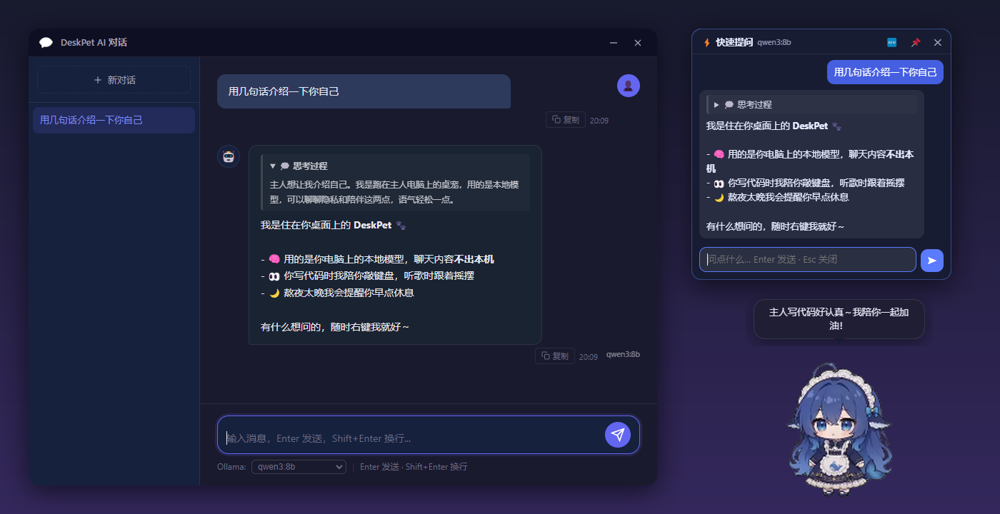
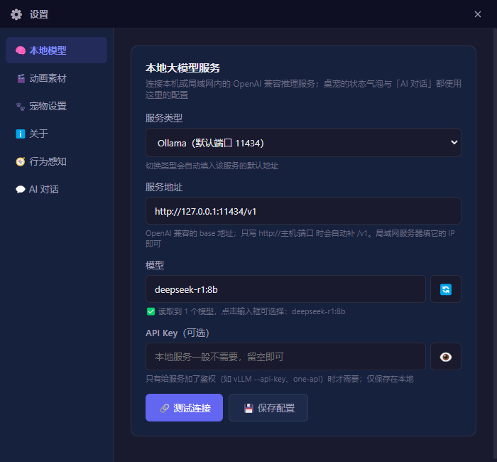
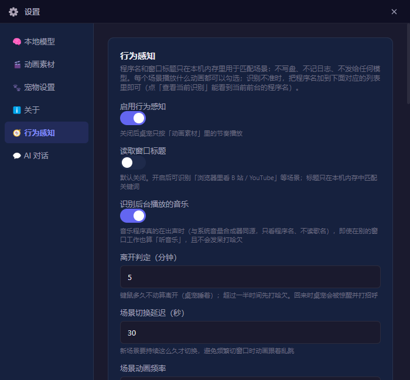

<div align="center">


# DeskPet · 本地大模型桌宠

**跑在你自己电脑上的 AI 桌宠：连接 Ollama / LM Studio / llama.cpp / vLLM，聊天内容不出本机；<br>还会看你在干什么，写代码时陪你敲键盘，听歌时跟着摇摆，熬夜太晚提醒你睡觉。**

[](https://github.com/ZhaishenGForSaken/deskpet-local-llm/releases/latest)
[](LICENSE)


[下载](#-下载安装) · [快速开始](#-快速开始) · [功能](#-功能) · [行为感知](#-行为感知) · [开发](#-开发)



</div>

---

## ✨ 功能

| | |
|---|---|
| 🧠 **本地模型** | 一键切换 Ollama / LM Studio / llama.cpp / vLLM / 任意 OpenAI 兼容服务；API Key 可选；局域网里另一台机器上的模型也能连 |
| 📋 **自动读取模型列表** | 不用手抄模型名；对话窗口底部可随时切换模型 |
| 💭 **思考过程** | DeepSeek-R1 / QwQ / Qwen3 等推理模型的 `<think>` 内容单独折叠显示，不回传进上下文 |
| ⚡ **快速提问** | 右键桌宠，头顶弹出一个小对话框，问完即走；和完整对话窗口共用会话 |
| 🎭 **桌宠跟着对话动** | 等待回复时冒泡思考、推理时碎碎念、输出时忙碌敲键盘、答完庆祝、出错叹气 |
| 💬 **回复同步到桌面** | 对话窗口不在前台时，回复以气泡显示在桌宠头上，点一下就回到对话 |
| 🧭 **行为感知** | 根据你正在用的程序切换场景动画：写代码、看文档、听音乐、看视频、打游戏、发呆、睡着 |
| 🗨️ **主动搭话** | 定时或右键「说句话」，让模型结合你当前的状态说一句；连续工作太久会提醒你休息 |
| 🟢 **模型状态** | 双击桌宠查看服务是否在线、当前模型、延迟、已加载到显存的模型（Ollama） |
| 🎬 **22 段动画 + 12 段场景动画** | 待机循环 + 偶尔播放动作，节奏可调；每个场景播什么动画都能勾选 |

## 📥 下载安装

到 [Releases](https://github.com/ZhaishenGForSaken/deskpet-local-llm/releases/latest) 下载 `DeskPet Setup x.y.z.exe`（Windows x64）并安装。

> 安装包没有代码签名，Windows SmartScreen 可能提示「已保护你的电脑」，点「更多信息 → 仍要运行」即可。

macOS 需要自行从源码打包（见 [打包](#打包)）。

## 🚀 快速开始

### 1. 准备一个本地模型服务（任选其一）

**Ollama（推荐）**：到 <https://ollama.com/download> 安装，然后下载一个模型：

```bash
ollama pull qwen3:8b          # 或 qwen2.5:7b / deepseek-r1:8b / llama3.1:8b ...
```

| 服务 | 启动方式 | 默认地址 |
|---|---|---|
| Ollama | 安装后自动在后台运行 | `http://127.0.0.1:11434/v1` |
| LM Studio | 左侧「Developer」→ Start Server | `http://127.0.0.1:1234/v1` |
| llama.cpp | `llama-server -m model.gguf --port 8080` | `http://127.0.0.1:8080/v1` |
| vLLM | `vllm serve Qwen/Qwen2.5-7B-Instruct --port 8000` | `http://127.0.0.1:8000/v1` |

### 2. 连接模型

右键桌宠 → **⚙️ 设置 → 🧠 本地模型**：选服务类型（会自动填地址）→ 点 🔄 读取模型 → **🔗 测试连接** → **💾 保存配置**。



> 💡 **连接局域网里另一台机器上的 Ollama**：在那台机器上设置环境变量 `OLLAMA_HOST=0.0.0.0` 并重启 Ollama，然后把地址填成 `http://那台机器的IP:11434/v1`。

## 🎮 使用

| 操作 | 效果 |
|---|---|
| 拖动 | 把桌宠放到任意位置（会被拎起来） |
| 单击 | 播放一段反应动画 |
| 双击 | 显示本地模型状态（可在「宠物设置」里改成随机说一句自定义的话） |
| 右键 → 💬 AI 对话 | 完整对话窗口：多会话、流式输出、思考过程、切换模型 |
| 右键 → ⚡ 快速提问 | 桌宠头顶的小对话框，Esc 关闭，📌 展开到完整窗口 |
| 右键 → 🗨️ 说句话 | 让模型结合你现在的状态说一句话 |

在「设置 → 💬 AI 对话」里可以调整 temperature、max_tokens、系统提示词（给桌宠设定人设）、主动搭话的间隔，也可以给对话单独指定另一个服务或模型。

## 🧭 行为感知

桌宠会根据**前台程序**和**键鼠是否空闲**判断你在做什么，并换上对应的动画：

| 场景 | 识别方式（可自行增删） | 默认动画 |
|---|---|---|
| 💻 写代码 | VS Code、Cursor、JetBrains 系列、Visual Studio、终端… | 写代码、忙碌点按 |
| 📚 学习 / 文档 | Office / WPS、PDF 阅读器、Notion、Obsidian、Zotero… | 轻快记录、深度思考 |
| 🎵 听音乐 | Spotify、网易云、QQ 音乐等**真的在出声**时，即使它在后台 | 小提琴演奏、悠闲哼歌 |
| 🎬 看视频 | PotPlayer、VLC、mpv 等播放器；开启「读取窗口标题」后还能识别浏览器里的 B 站 / YouTube | 撸猫、悠闲哼歌 |
| 🎮 打游戏 | 原神、星穹铁道、LOL、CS2、Minecraft 等常见游戏 | 玩游戏气急败坏 |
| 🥱 发呆 → 😴 睡着 | 键鼠一段时间没动（默认 5 分钟睡着），回来时被惊醒 | 哈欠连天 → 原地小憩 |

此外还有**吃饭时间、熬夜提醒**，以及**元旦、春节、中秋、圣诞**的节日动画；支持在设置里**自定义场景规则**（程序名 / 标题关键词 → 动画）。



### 🔒 隐私

- 默认**只读取前台程序名**；窗口标题**默认不读**，需要手动开启。
- 程序名和标题只在本机内存里用来匹配场景：**不写盘、不记日志、不发给模型**。
- 主动搭话时，发给模型的只有「主人在写代码，已经 40 分钟了」这类场景描述。
- 不需要的话，可以在「设置 → 🧭 行为感知」里整个关掉。

## 🎬 动画素材

仓库自带的 WebM 动画来自 [dsh-pet](https://github.com/PC2005-cloud/dsh-pet)（MIT，见 [`assets/animations/LICENSE-dsh-pet.txt`](assets/animations/LICENSE-dsh-pet.txt)）：

```
assets/animations/
├── idle/    待机与动作动画（随机池）
├── click/   点击反应
└── scene/   场景 / 节日动画（只由行为感知触发）
```

想换成自己的角色：把带透明通道的 WebM 放进对应文件夹，然后到「设置 → 🎬 动画素材」里勾选，并给每段动画指定「待机」或「动作」。在「播放节奏」里可以调整动作出现的间隔。

## 🛠 开发

```bash
git clone https://github.com/ZhaishenGForSaken/deskpet-local-llm.git
cd deskpet-local-llm
npm install
npm start          # 或 npm run dev（带开发日志）
```

Windows 上也可以双击 `DeskPet.vbs` 启动，不会弹出命令行窗口。

### 自检

```bash
npm run check           # 静态自检：地址解析、<think> 分流、场景判定、离线报错等
npm run check:renderer  # 启动真实 Electron 的冒烟测试
```

### 打包

```bash
npm run build:win   # → dist/DeskPet Setup <版本>.exe
npm run build:mac   # → dmg（需要在 macOS 上执行）
```

> Windows 上首次打包如果报 `Cannot create symbolic link`（解压 winCodeSign 时），可以开启「开发者模式」或用管理员权限运行一次。

配置保存在 `%APPDATA%\DeskPet`（Windows）或 `~/Library/Application Support/DeskPet`（macOS）。

### 项目结构

```
src/
├── main/                     # 主进程：桌宠 / 气泡 / 右键菜单 / 设置窗口、托盘、IPC
├── renderer/                 # 桌宠、气泡、菜单、设置页
├── shared/local-llm.js       # 本地服务预设、地址解析、模型列表、状态检测
└── plugins/
    ├── llm-chat/             # AI 对话、快速提问、主动搭话
    └── activity-sense/       # 行为感知：前台程序 / 音频 / 空闲检测 → 场景
```

功能都以插件形式实现，插件之间通过消息总线通信。插件开发文档见 [`src/plugins/README.md`](src/plugins/README.md)。

## 🙏 致谢

- [isKage/desk-llm-pet](https://github.com/isKage/desk-llm-pet)：本项目的基础（MIT）。感谢原作者允许分享这个改版。
- [PC2005-cloud/dsh-pet](https://github.com/PC2005-cloud/dsh-pet)：桌宠动画素材（MIT）。动画中的角色形象版权归其原作者所有。

## 📄 License

[MIT](LICENSE)
